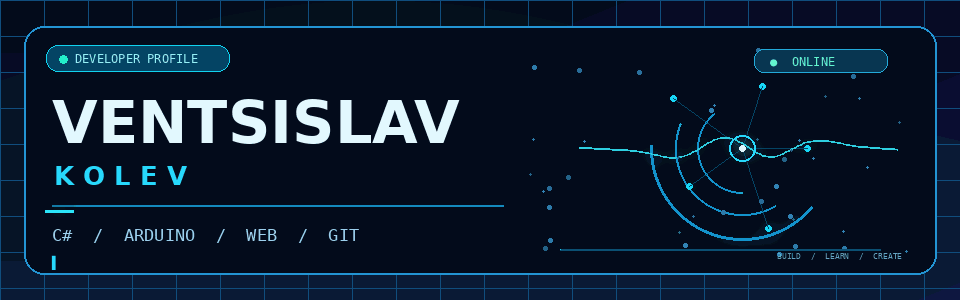
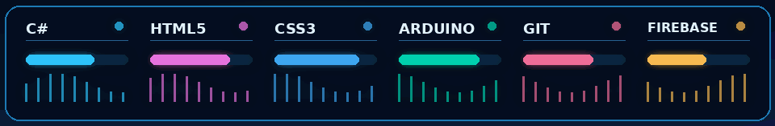

<!-- Ventsislav Kolev · GitHub Profile · Neon Edition -->

<div align="center">
  
</div>

<h3 align="center">Software Development · Embedded Systems · Automotive Technology</h3>

<p align="center">
  <a href="https://github.com/ventsislav67?tab=followers"></a>
  <a href="https://github.com/ventsislav67?tab=repositories"></a>
  <a href="https://softuni.bg/certificates/details/208375/f2d3f461"></a>
</p>

<p align="center">
  <a href="https://github.com/ventsislav67">GitHub</a> &nbsp;•&nbsp;
  <a href="https://github.com/ventsislav67?tab=repositories">Repositories</a> &nbsp;•&nbsp;
  <a href="https://softuni.bg/certificates/details/208375/f2d3f461">Certificate</a>
</p>

---

### 🧑‍💻 About me

```yaml
name: Ventsislav Kolev
username: ventsislav67
interests: [Programming, Cars, Technology]
currently_learning: [C#, Arduino, Web Development]
exploring: [Firebase, Real-time Multiplayer, Embedded Systems]
mission: "Learn. Build. Improve. Repeat."
```

I'm passionate about turning ideas into working projects — from **C# applications** and **web interfaces** to **Arduino electronics**. I'm also interested in **automotive technology**, embedded systems, and performance-focused software.

### ⚡ Tech stack in motion

<p align="center">
  
</p>

<p align="center">
  
  &nbsp;
  
  &nbsp;
  
  &nbsp;
  
  &nbsp;
  
  &nbsp;
  
  &nbsp;
  
  &nbsp;
  
  &nbsp;
  
</p>

### 🚀 What I'm building

| 💻 Software | 🤖 Embedded systems | 🌐 Web & real-time |
|:---:|:---:|:---:|
| C# console tools and Windows Forms applications | Arduino sensors, RGB LEDs, LCD displays and automation | Responsive websites and multiplayer experiments |
| **Clean logic, useful interfaces** | **Hardware + code** | **Interactive experiences** |

### 📊 GitHub in real time

<!-- These local SVG cards are updated automatically by GitHub Actions. -->
<p align="center">
  
  
</p>

### 🐍 Contribution activity — animated

<!-- The animation is generated from the real GitHub contribution calendar. -->
<div align="center">
  <picture>
    <source media="(prefers-color-scheme: dark)" srcset="./github-snake-dark.svg" />
    <source media="(prefers-color-scheme: light)" srcset="./github-snake-light.svg" />
    
  </picture>
</div>

<p align="center"><sub>Automatically regenerated from actual GitHub contributions by GitHub Actions.</sub></p>

### 🎓 Education & achievements

<p align="center">
  <a href="https://softuni.bg/certificates/details/208375/f2d3f461">
    
  </a>
</p>

<p align="center">
  <a href="https://softuni.bg/trainings/4414/programming-basics-with-csharp-february-2024">Programming Basics with C# — February 2024</a>
  &nbsp;|&nbsp;
  <a href="https://softuni.bg/certificates/details/208375/f2d3f461">View certificate ↗</a>
</p>

---

<p align="center"><strong>Building ideas into reality, one commit at a time.</strong></p>
<p align="center"><sub>Designed for clarity · Animated locally · GitHub stats updated automatically</sub></p>
