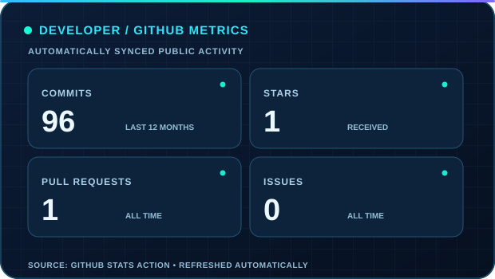
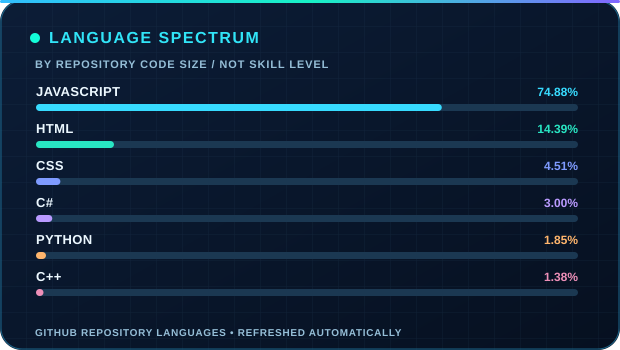
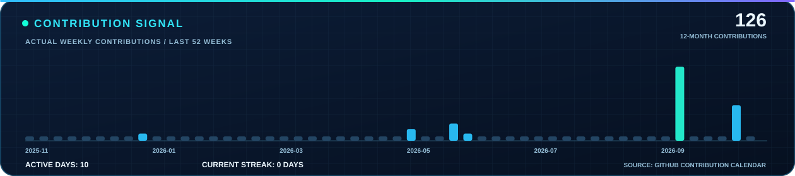

<!-- Ventsislav Kolev | GitHub Profile — Neon Developer Edition -->

  

  <h2>Hi, I'm Ventsislav 👋</h2>
  
<strong>Software Development · Arduino & Embedded Systems · Automotive Technology</strong>

  
Building practical software, experimenting with electronics, and turning ideas into working projects.

  
  
  

---

## 📡 Mission Control — GitHub Dashboard

  
  
  

Data from GitHub · Automatically refreshed approximately every 6 hours by GitHub Actions · GitHub image caching may delay updates.

## 🐍 Contributions in Motion

  <picture>
    <source media="(prefers-color-scheme: dark)" srcset="./github-snake-dark.svg" />
    <source media="(prefers-color-scheme: light)" srcset="./github-snake-light.svg" />
    
  </picture>
  
An animated visualization of my real GitHub contribution calendar.

---

## 🧬 About Me — Interactive Developer Profile

  
  
Animated developer panel · Select a category below to explore my skills and projects

<strong>💻 01 / SOFTWARE ENGINEERING — C# &amp; .NET</strong> · Click to explore

I enjoy building useful desktop tools, practicing clean program logic and experimenting with Windows Forms interfaces.

<strong>Core focus:</strong> C# · .NET · Console Applications · Windows Forms

🔗 <a href="https://github.com/ventsislav67/PRAKTIKA-2025"><strong>Explore my Windows Forms practice →</strong></a>

<strong>🤖 02 / EMBEDDED SYSTEMS — Arduino</strong> · Click to explore

Combining hardware and software through ultrasonic sensors, RGB LEDs, buzzer alerts and LCD displays.

<strong>Core focus:</strong> Arduino · HC-SR04 · Sensors · LCD · Electronics

🔗 <a href="https://github.com/ventsislav67/arduino-project"><strong>Open my Arduino distance-assistant project →</strong></a>

<strong>🌐 03 / WEB &amp; REAL-TIME — Firebase</strong> · Click to explore

I work on responsive websites and explore real-time applications, web interfaces and Firebase-based ideas.

<strong>Core focus:</strong> HTML · CSS · JavaScript · Firebase · UX

🔗 <a href="https://github.com/ventsislav67/RoadMind"><strong>Explore the RoadMind web platform →</strong></a>

<strong>🚘 04 / AUTOMOTIVE TECHNOLOGY</strong> · Click to explore

I'm interested in connected vehicles, sensor systems, automotive electronics and how software makes driving technology smarter and safer.

<strong>Interests:</strong> Automotive software · Sensors · Embedded technology · User experience

🔗 <a href="https://github.com/ventsislav67?tab=repositories"><strong>Explore all my engineering projects →</strong></a>

<strong>⌨️ TERMINAL / developer-info --all</strong> · Expand developer details

**Developer:** Ventsislav Kolev

**GitHub:** [@ventsislav67](https://github.com/ventsislav67)

**Currently learning:** C#, Arduino, Web Development

**Exploring:** Firebase, Real-time Applications, Embedded Systems

**Mindset:** Learn → Build → Improve → Repeat

  
  

## ⚡ Tech Stack in Motion

  
  

    
    &nbsp;&nbsp;
    
    &nbsp;&nbsp;
    
    &nbsp;&nbsp;
    
    &nbsp;&nbsp;
    
    &nbsp;&nbsp;
    
    &nbsp;&nbsp;
    
    &nbsp;&nbsp;
    
    &nbsp;&nbsp;
    
  

## 🚀 Selected Projects

**🚘 [RoadMind](https://github.com/ventsislav67/RoadMind)** — A web platform concept for driving theory exam preparation, with learning content, quizzes and planned AI-assisted features.

**🔧 [Arduino Distance Assistant](https://github.com/ventsislav67/arduino-project)** — A distance measuring project using the HC-SR04 sensor, LCD display, RGB LEDs and a buzzer.

**💻 [PRAKTIKA 2025](https://github.com/ventsislav67/PRAKTIKA-2025)** — Practice work featuring a Windows Forms application.

**✨ [Приказка Online](https://github.com/ventsislav67/prikazka-online)** — Bulgarian-language AI story generator built with Node.js, Express and JavaScript.

  <a href="https://github.com/ventsislav67?tab=repositories"><strong>Explore all repositories ↗</strong></a>

## 🎓 Education & Achievements

**SoftUni · Programming Basics with C# (February 2024)**

[View verified certificate](https://softuni.bg/certificates/details/208375/f2d3f461) · [Course information](https://softuni.bg/trainings/4414/programming-basics-with-csharp-february-2024)

---

  
  
<strong>Building ideas into reality, one commit at a time.</strong>

  
NEON DEVELOPER EDITION · SELF-HOSTED ANIMATED DASHBOARD · AUTOMATED WITH GITHUB ACTIONS

